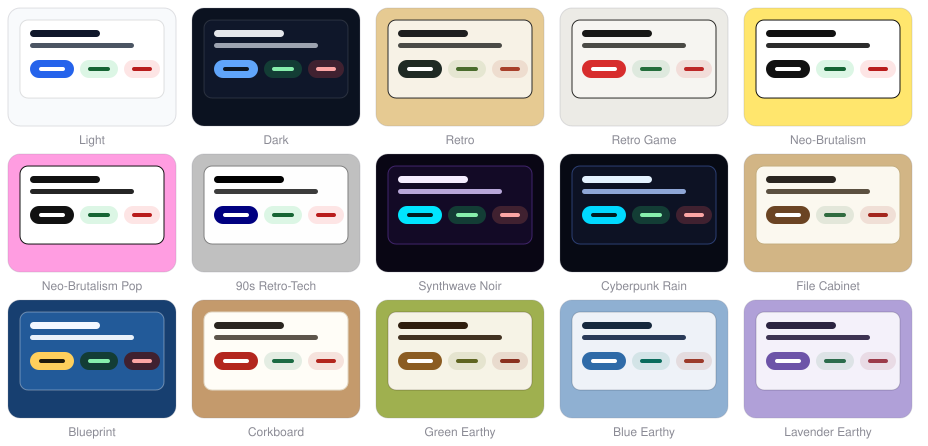
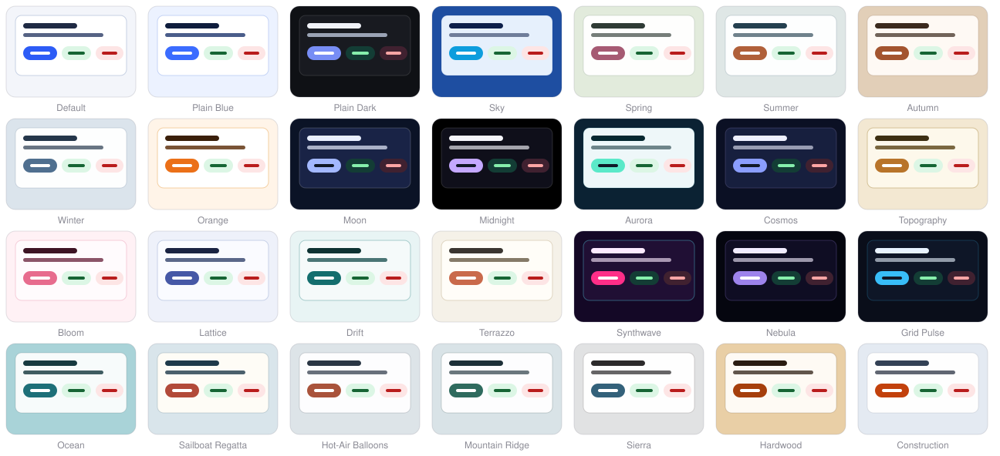
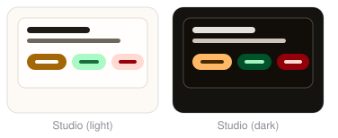

# eztheme

Themes as data. It has 15 app looks, 28 form looks and a Material 3 "Studio" theme. It also has the colour rules that work out everything else from a few colours, contrast checks, and output as CSS custom properties in either of two name sets. There are no runtime dependencies.



- **A theme is a few colours.** You give a palette (accent, page, surface, text, status colours). eztheme works out the surface ladder (four steps back from the card), an outline that clears 3:1, and status ink/wash pairs that read at chip sizes. Themes can also remap hues picked in code: "when the app asks for green, use my jade".
- **Two vocabularies.** It writes ezinputs names (`--ez-accent`, `--ez-surface-high`, `--ez-danger-ink`, …) or Material 3 names (`--md-sys-color-primary`, `--md-sys-color-surface-container`, …), or both. An app keeps its own CSS and still takes every theme.
- **Contrast is checked.** Every form theme is tested against a contract that says which token is read on which surface and how readable it must be. App themes must keep text at 4.5:1 on all their surfaces.
- **No framework.** It's plain data and functions. `eztheme/dom` applies a theme to a page. `eztheme/mui` turns one into MUI theme options, without importing MUI.

## Install

```sh
npm install eztheme
```

No build step? Use the stylesheets directly, or copy `dist/eztheme.min.js` into your project:

```html
<link rel="stylesheet" href="vendor/themes.css">   <!-- every theme -->
<html data-eztheme="corkboard">                    <!-- pick one -->
```

## Use it

```js
import { applyTheme } from 'eztheme/dom';

applyTheme('synthwave-noir');           // writes the theme's custom properties on <html>
applyTheme('form:sky', { names: 'ez' }); // a form look, ezinputs names only
applyTheme('studio');                   // light/dark follows data-theme="dark" or the OS
```

```css
.card   { background: var(--ez-surface); border: 1px solid var(--ez-border); color: var(--ez-text); }
.button { background: var(--ez-accent); color: var(--ez-on-accent); border-radius: var(--ez-radius); }
.chip.error { background: var(--ez-danger-soft); color: var(--ez-danger-ink); }
```

```js
import { getTheme, themeTokens, toCSS, auditFormTheme, contrastRatio } from 'eztheme';

themeTokens(getTheme('corkboard'), 'md');   // { '--md-sys-color-primary': '#b3261e', … }
toCSS(getTheme('blueprint'), { selector: '.preview' });
auditFormTheme(getTheme('form:sky'));       // each pairing, its ratio, pass or not
```

## Form themes

The colours a public form is painted with. Each one is a token bag (page, surface, text, muted, accent, input, danger, font), with helpers for the inks a form reads.



## Studio

Photo Studio's look: amber on warm neutrals, in light and dark, written directly as Material 3 tokens (a reference palette, colour roles, type sizes, corners, motion). `dist/studio.css` is a drop-in for an app on Material names. Light is the default; dark comes from the OS, or from `data-theme="dark"` on the root.



## What's not in it

- **Fonts.** Themes name font stacks but don't load fonts. Load them yourself (Google Fonts, `next/font`, …).
- **Component styling.** A theme gives colours, fonts and corners. Corkboard's pins and File Cabinet's tabs are styling in the app that uses them.
- **Animated form scenes.** These are not included yet.

## Demo and pictures

`npm run demo` serves a page with a picker for every theme. The pictures in this README are drawn from the themes themselves: `npm run build && npm run readme-images`.

## Credits

The token names follow Material 3's published design tokens (Google). This project is independent and not affiliated with or endorsed by Google. The themes come from [ezinputs](https://ezinputs.com).

## License

MIT © James Dominguez
